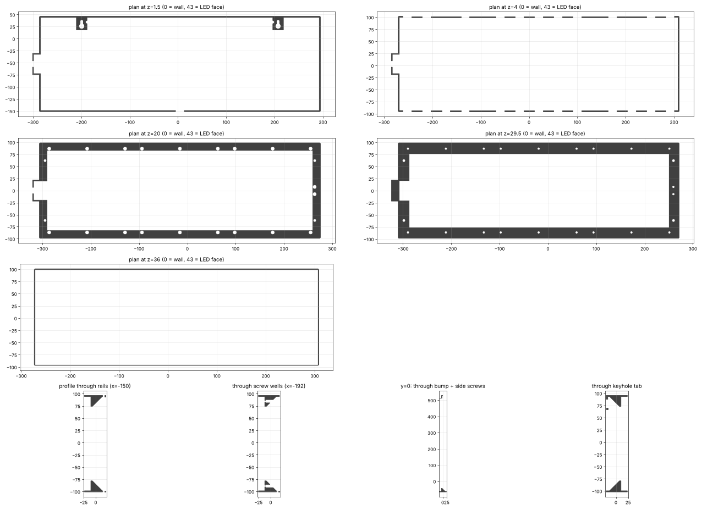

# Rear frame for the 3× 64×64 P3 sign (576 × 192 mm)

Nothing covers the LEDs. The panels drop in from the front onto a ledge and are
held by M3 screws into their own threaded holes, driven from the back. A 2.4 mm
wall wraps the panel edges flush with the LED face, and the frame stands the
panels 30 mm off the wall for wiring. A bump on the left side (seen from the
front) covers the Matrix Portal S3 where it sticks out, with a slot for USB-C.

Finished size: 581.6 × 197.6 × 43 mm, plus a 14 mm bump on one side.

**Not test-fitted yet.** The hole pattern comes from the "Waveshare LED Matrix"
housing STL, not from the real panels. Print `test_jig.stl` first (about 20
minutes) and hold it against the back of one panel.

## Measure before printing (top of `frame.py`)
| Variable | Default | What to measure |
|---|---|---|
| `PANEL_D` | 13 | LED face to the flat back rim of the panel's plastic frame |
| `BAY_OUT` | 12 | How far the Matrix Portal sticks out past the panel edge, plus 3 mm |
| `BAY_Y` | 0 | Board centre above (+) or below (−) the panel's mid-height |
| `BAY_SIDE` | left | Side the board is on, seen from the front |
| `REAR` | 27 | Deepest thing behind the panels, minus 3 mm |

Rebuild: `pip install cadquery && python3 frame.py`

## Parts (`stl/`)
| File | Qty | Size (mm) |
|---|---|---|
| `test_jig.stl` | 1 | 192 × 192 × 1.2, print first |
| `side_left.stl` | 1 | 185 × 198 × 43 (has the Matrix Portal bump) |
| `side_right.stl` | 1 | 171 × 198 × 43 |
| `mid_top.stl`, `mid_bottom.stl` | 1 each | 240 × 23 × 43 (bottom has the power cable notch) |
| `tie_plate.stl` | 2 | 34 × 30 × 3, joins two panels across a seam |

Print everything as modelled (wall side on the bed, LED side up), no supports.
0.4 nozzle, 0.2 mm layers, 3 walls, 15% infill, PLA or PETG. The two side
pieces fit the P1S plate one at a time; the two middle rails fit together.

## Hardware
- About 28× M3×6 screws (1.6 mm of plastic under the head, 4.4 mm into the panel).
- 4× 14 mm pieces of 1.75 mm filament as dowels at the four joints.
- 2 wall screws, heads up to 9 mm, 406 mm (16") apart.

## Assembly
1. Lay the three panels face down on a towel, edges touching.
2. Screw a tie plate across each seam (4 screws each, at mid-height).
3. Push the filament dowels into the middle rails, set the rails and the two
   side pieces over the panels, and drive the screws down the wells.
4. Plug in the Matrix Portal and wiring; the power lead leaves through the
   notch at the bottom centre.
5. Hang on the two keyholes.

